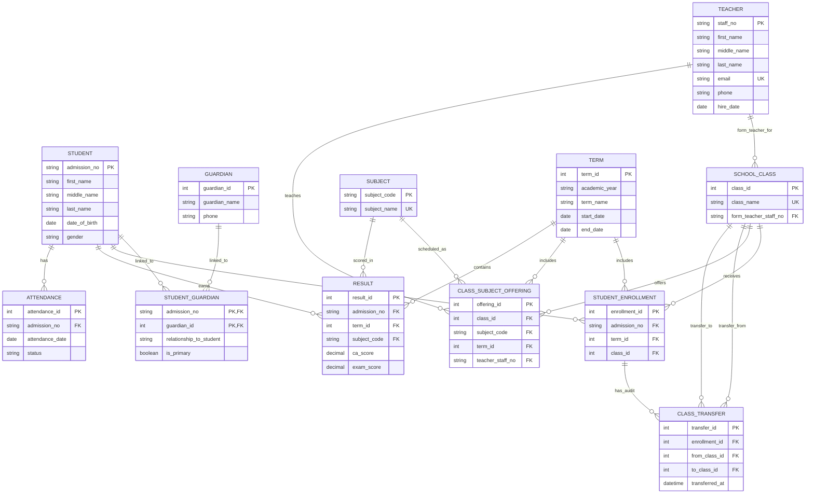

# Secondary School Database

A normalized MySQL/MariaDB sample for students, guardians, teachers, classes, subjects, terms, results, attendance, and class-transfer auditing. The sample records are fictional.

The schema uses InnoDB and `utf8mb4`. Use MySQL 8.0.16+ or MariaDB 10.2.1+ so the `CHECK` constraints are enforced.

## Load the database

Start MySQL in XAMPP. To use phpMyAdmin, also start Apache. From **Command Prompt**, run these commands from this folder:

```cmd
cd /d "C:\xampp\htdocs\swd\ola-08-school-database"
"C:\xampp\mysql\bin\mysql.exe" -u root -e "CREATE DATABASE IF NOT EXISTS swd_school CHARACTER SET utf8mb4 COLLATE utf8mb4_unicode_ci;"
"C:\xampp\mysql\bin\mysql.exe" -u root swd_school < schema.sql
"C:\xampp\mysql\bin\mysql.exe" -u root swd_school < seed.sql
"C:\xampp\mysql\bin\mysql.exe" -u root swd_school < indexes.sql
"C:\xampp\mysql\bin\mysql.exe" -u root swd_school < queries.sql
"C:\xampp\mysql\bin\mysql.exe" -u root swd_school < procedures.sql
"C:\xampp\mysql\bin\mysql.exe" -u root swd_school < transactions.sql
```

`schema.sql` intentionally drops and recreates its tables. **Importing it again erases the current table data.** Export a backup first if you need to keep any records. Re-run `indexes.sql` after a schema reset; it is intended to be run once per schema installation. The query script runs the reports and creates or replaces the two views. The procedure and transaction scripts install routines but do not call them.

`queries.sql`, `procedures.sql`, and `transactions.sql` use `DELIMITER`-compatible routine syntax where needed; the MySQL command line shown above supports it.

## File guide

| File | Purpose |
|---|---|
| `schema.sql` | Tables, keys, foreign keys, validation checks, result-validation triggers, and dependency-ordered reset. |
| `seed.sql` | Fictional Nigerian sample data: 3 classes, 8 subjects, 6 teachers, 30 students, 1 term, 240 results, and 150 attendance records. |
| `indexes.sql` | Secondary indexes for the term-based reports. Run once after `schema.sql`. |
| `queries.sql` | Eight numbered reports and the `v_student_results` and `v_class_summary` views. |
| `procedures.sql` | `sp_record_result`, which validates and inserts or updates a result. |
| `transactions.sql` | `class_transfers`-based class-change examples and the rollback-safe `sp_move_student_class_safe` procedure. |
| `index.html` | Static dashboard preview; it is not connected to the database. |

## ERD



The result trigger checks that the student's enrolled class has the subject offering for that term. `UNIQUE (admission_no, subject_code, term_id)` prevents duplicate results, and the attendance unique key prevents more than one row per student per day.

## Three useful reports

The complete, numbered SQL is in `queries.sql`; these are the three reports used for the performance exercise.

### 3. Class position

The CTE first computes each student's average across their term subjects. `RANK()` partitions by class and term, so ranks restart for each class and ties share a rank.

```sql
RANK() OVER (
    PARTITION BY class_id, term_id
    ORDER BY average_score DESC
) AS class_position
```

The file includes a correlated-count fallback for MySQL 5.7, which has no window functions.

### 5. Students failing multiple subjects

The query counts results below 40 for each student, then `HAVING` keeps only groups with two or more failed subjects. `HAVING` is needed because the condition applies to an aggregate.

```sql
GROUP BY student, class
HAVING SUM(CASE WHEN ca_score + exam_score < 40 THEN 1 ELSE 0 END) >= 2
```

### 7. Attendance below 80%

A derived table counts recorded days and days attended for each student. The report treats both **Present** and **Late** as attended, then filters percentages below 80%. Its denominator is recorded attendance rows in the selected term; use a school-calendar table if the denominator must include days with missing attendance records.

```sql
100.0 * attended_days / NULLIF(recorded_days, 0) < 80
```

## Indexes and EXPLAIN

`EXPLAIN` was run on the loaded 30-student sample before and after `indexes.sql`, followed by `ANALYZE TABLE`. The table below highlights the rows that changed most. `rows` is the optimizer's estimate per access, not a measured runtime or guaranteed actual row count.

| Query | Before: table / type / key / rows | After: table / type / key / rows |
|---|---|---|
| 3 | `results` / `ALL` / `NULL` / 240; `student_enrollments` / `eq_ref` / `uq_enrollment_student_term` / 1 | `results` / `ref` / `idx_results_term_student_subject_scores` / 4; `student_enrollments` / `ref` / `fk_enrollments_class` / 5 |
| 5 | `results` / `ALL` / `NULL` / 240; `student_enrollments` / `eq_ref` / `uq_enrollment_student_term` / 1 | `results` / `ref` / `idx_results_term_student_subject_scores` / 4; `student_enrollments` / `ref` / `idx_enrollments_term_class_student` / 5 |
| 7 | `student_enrollments` / `ALL` / `NULL` / 30; `attendance` / `ref` / `uq_attendance_student_day` / 1 | `student_enrollments` / `ref` / `fk_enrollments_class` / 5; `attendance` / `ref` / `uq_attendance_student_day` / 2 |

- `ALL` means a table scan; `ref` is a non-unique indexed lookup; `eq_ref` is a unique lookup returning at most one row; `const` is a single-row lookup. `index` means a full index scan.
- `idx_results_term_student_subject_scores` starts with term and student, then covers subject and both scores. This replaces the full results scan in queries 3 and 5.
- `idx_enrollments_term_class_student` supports term/class grouping and is selected for query 5. For query 7 the optimizer chooses the existing class foreign-key index while evaluating a class at a time.
- Query 7 already uses `uq_attendance_student_day (admission_no, attendance_date)`, which supports its student/date-range lookup; another attendance index was not needed.

The sample is intentionally small, so plans and `rows` estimates can differ on a larger database. To repeat the measurements, run `EXPLAIN` before loading `indexes.sql`, then run `ANALYZE TABLE results, student_enrollments, attendance;` and repeat it. The exact reports are in `queries.sql`.

## Procedures and transactions

Install `procedures.sql` to create `sp_record_result`. For example:

```sql
CALL sp_record_result('ADM-J1-001', 'ENG', 1, 32.00, 55.00);
```

It rejects out-of-range scores and subjects not offered to the student's class in that term. A duplicate student/subject/term result is updated.

`transactions.sql` defines `sp_move_student_class_safe`. A valid example is:

```sql
CALL sp_move_student_class_safe('ADM-J1-001', 1, 'JSS2 A');
```

That call changes the enrollment and inserts a `class_transfers` audit row in the same transaction. If the target class does not exist, the procedure raises an error and rolls back. The direct two-statement transaction example in `transactions.sql` is commented so it cannot move a student accidentally when the file is imported.

## Export the full database from phpMyAdmin

1. Start **Apache** and **MySQL** in the XAMPP Control Panel, then open `http://localhost/phpmyadmin`.
2. Select `swd_school` in the left sidebar and open **Export**.
3. Choose **Custom** and **SQL**. Select all tables, and include both **Structure** and **Data**.
4. In the export options, include views, triggers, and routines/procedures if those options are shown. Enable `CREATE DATABASE`/`USE` statements if you want the dump to recreate the database.
5. Choose **Save output to a file**, name it `database.sql`, and click **Export** or **Go**. If phpMyAdmin downloads it as `swd_school.sql`, rename the downloaded file to `database.sql`.
